<p align="center">
  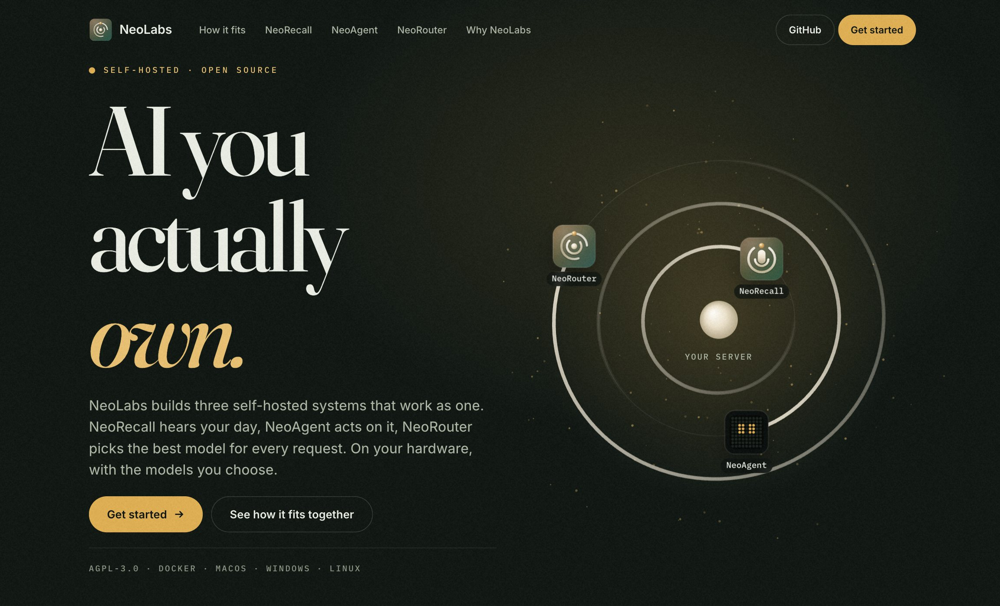
</p>

<h1 align="center">NeoLabs</h1>

<p align="center"><strong>AI you actually own.</strong></p>

<p align="center">
  Three self-hosted systems that work as one.<br>
  On your hardware, with the models you choose.
</p>

<p align="center">
  <a href="https://github.com/NeoLabs-Systems/NeoRecall"></a>
  <a href="https://github.com/NeoLabs-Systems/NeoAgent"></a>
  <a href="https://github.com/NeoLabs-Systems/NeoRouter"></a>
</p>

<p align="center">
  <a href="https://discord.gg/f59rg2RwUT"></a>
</p>

<table>
  <tr>
    <td width="33%" valign="top">
      <a href="https://github.com/NeoLabs-Systems/NeoRecall"></a>
      <h3><a href="https://github.com/NeoLabs-Systems/NeoRecall">NeoRecall</a></h3>
      Private audio memory you host yourself.<br>
      <b>It hears your day.</b>
    </td>
    <td width="33%" valign="top">
      <a href="https://github.com/NeoLabs-Systems/NeoAgent"></a>
      <h3><a href="https://github.com/NeoLabs-Systems/NeoAgent">NeoAgent</a></h3>
      The personal AI agent you host yourself.<br>
      <b>It acts on it, and asks first.</b>
    </td>
    <td width="33%" valign="top">
      <a href="https://github.com/NeoLabs-Systems/NeoRouter">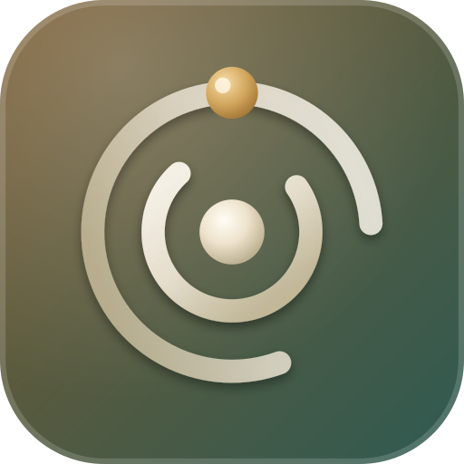</a>
      <h3><a href="https://github.com/NeoLabs-Systems/NeoRouter">NeoRouter</a></h3>
      Every model. One endpoint.<br>
      <b>It picks the best one for every request.</b>
    </td>
  </tr>
</table>

---

<p align="center">
  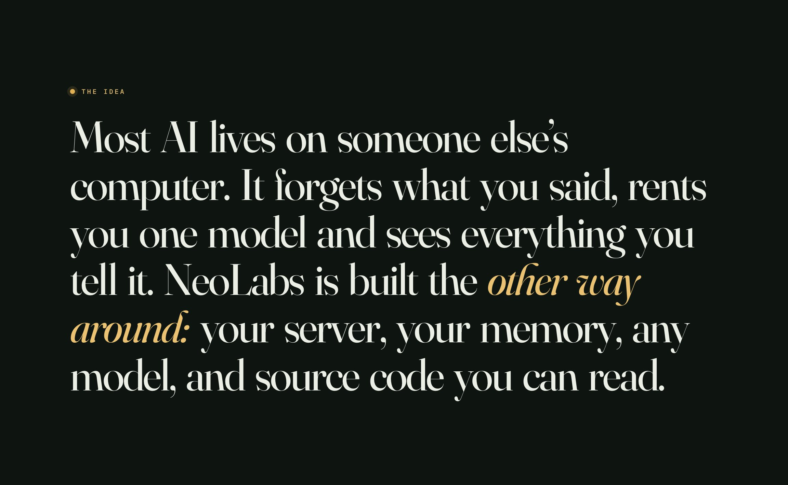
</p>

## 🧭 One sentence, three systems

You make a small promise in a meeting. Here is what happens next. This is an example run.

<table>
  <tr>
    <td width="50%">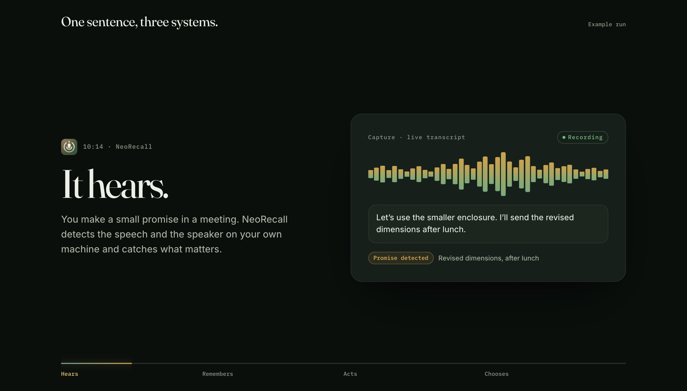</td>
    <td width="50%">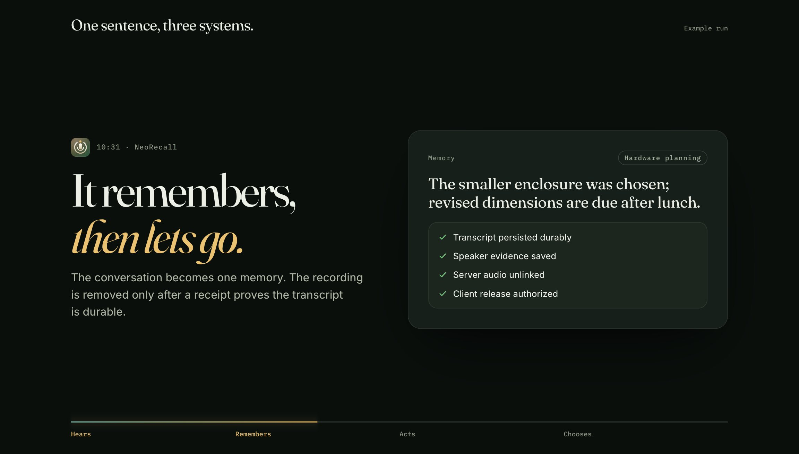</td>
  </tr>
  <tr>
    <td>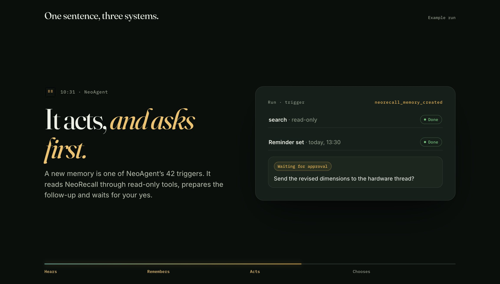</td>
    <td>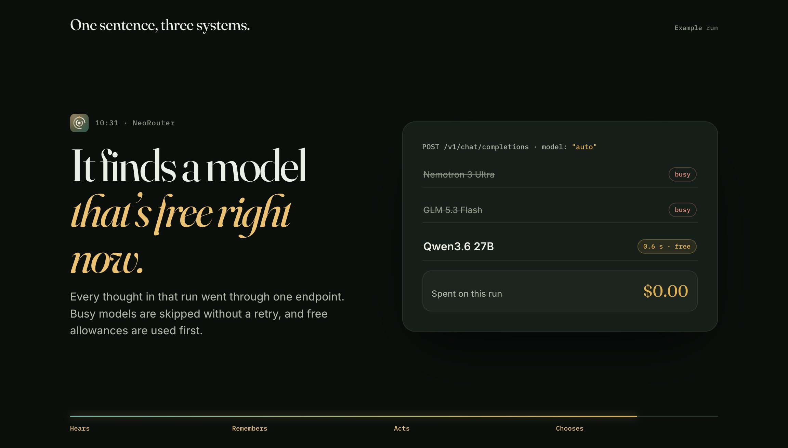</td>
  </tr>
</table>

## ✨ The systems

Each one is complete alone and better connected.

<a href="https://github.com/NeoLabs-Systems/NeoRecall">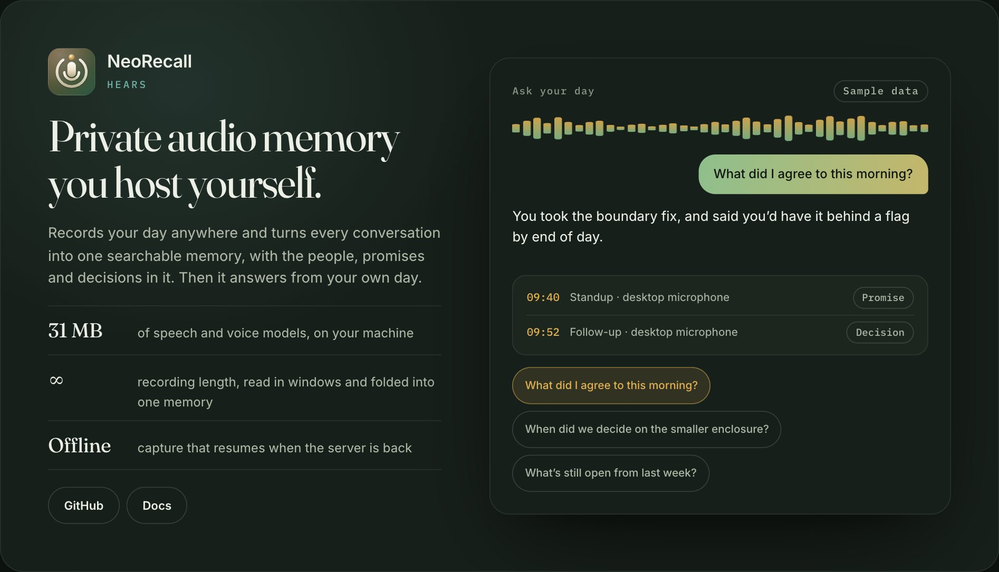</a>

**[NeoRecall](https://github.com/NeoLabs-Systems/NeoRecall)** · [Docs](https://neolabs-systems.github.io/NeoRecall/docs/)

<a href="https://github.com/NeoLabs-Systems/NeoAgent">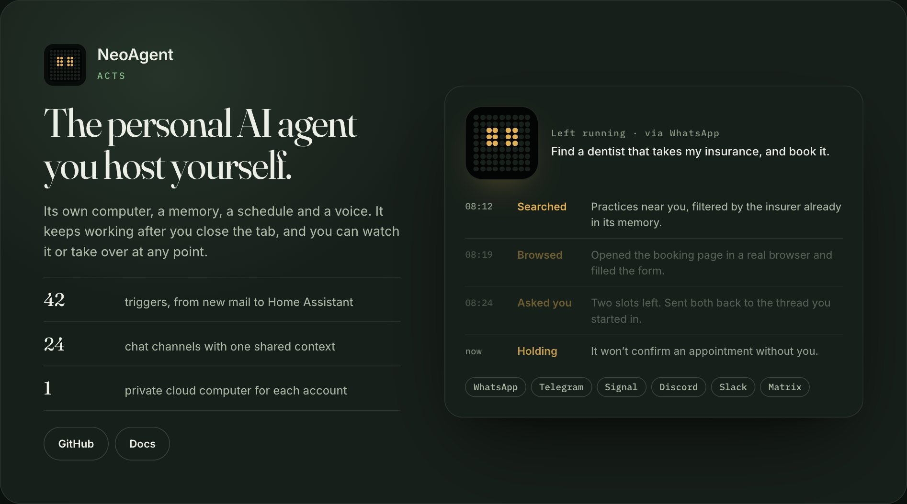</a>

**[NeoAgent](https://github.com/NeoLabs-Systems/NeoAgent)** · [Docs](https://neolabs-systems.github.io/NeoAgent/docs/)

<a href="https://github.com/NeoLabs-Systems/NeoRouter">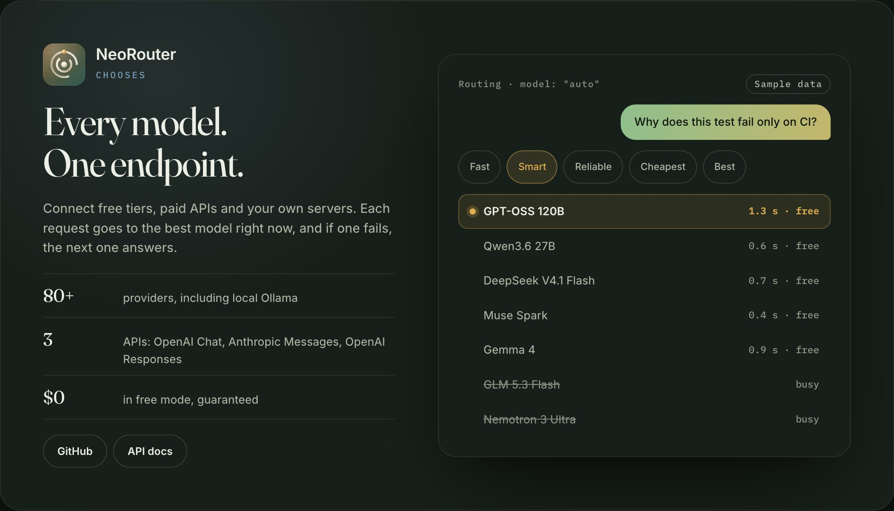</a>

**[NeoRouter](https://github.com/NeoLabs-Systems/NeoRouter)** · [API docs](https://neolabs-systems.github.io/NeoRouter/api/)

<p align="center">
  
</p>

## 🔗 How they connect

| Connection | What you get |
| --- | --- |
| **NeoRecall → NeoAgent** | NeoAgent signs in with OAuth and gets seven read-only tools and three triggers. It can search your memories and can never change them. |
| **NeoAgent → NeoRouter** | Connect NeoRouter for the whole server or for one person. Your agents stop depending on any single provider's uptime. |
| **NeoRecall → NeoRouter** | NeoRecall works with any OpenAI-compatible transcription and language service, so NeoRouter's endpoint can supply both. |

Prefer your own tools? Paste NeoRecall's MCP URL into Claude, ChatGPT or Cursor for read-only recall.

## ⚖️ Why NeoLabs

<p align="center">
  
</p>

The hosted column comes from the [dated comparison in NeoAgent's docs](https://github.com/NeoLabs-Systems/NeoAgent/blob/main/docs/why-neoagent.md).

<p align="center">
  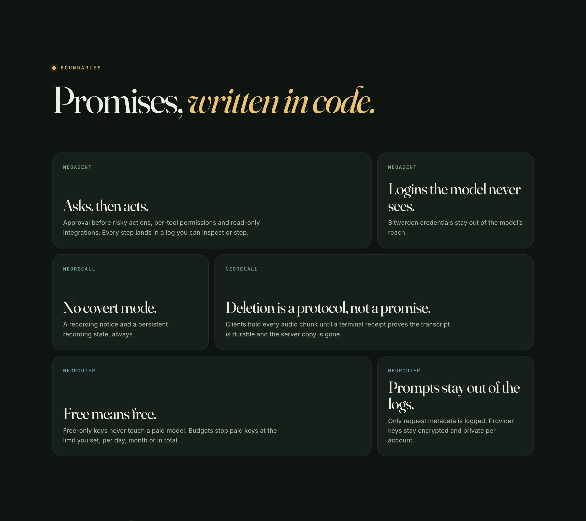
</p>

## 🚀 Get started

Pick the one you need today. Each runs on a home server, a NAS, a VPS or your own computer, and the first account you create becomes the administrator.

**[NeoRecall](https://github.com/NeoLabs-Systems/NeoRecall)**, then open http://localhost:4500

```bash
bash <(curl -fsSL https://raw.githubusercontent.com/NeoLabs-Systems/NeoRecall/main/install.sh)
```

**[NeoAgent](https://github.com/NeoLabs-Systems/NeoAgent)**, then open http://localhost:3333

```bash
bash <(curl -fsSL https://raw.githubusercontent.com/NeoLabs-Systems/NeoAgent/main/install.sh)
```

**[NeoRouter](https://github.com/NeoLabs-Systems/NeoRouter)**, then open http://localhost:4600/app

```bash
bash <(curl -fsSL https://raw.githubusercontent.com/NeoLabs-Systems/NeoRouter/main/install.sh)
```

## 🌐 This repository

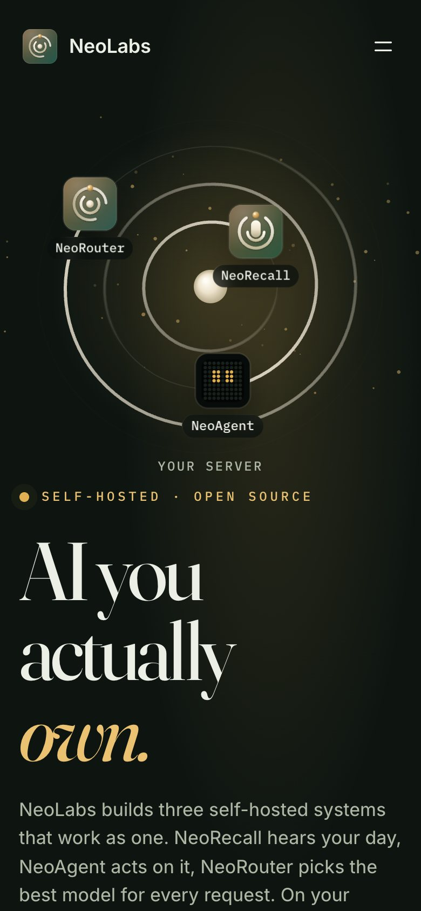

This is the NeoLabs home page: static HTML, CSS and JavaScript with no runtime dependencies. You need Node.js 20 or newer to build it.

```bash
npm start
```

That builds the site into `dist/` and serves it at http://localhost:4870.

| To change | Edit |
| --- | --- |
| A system's copy, facts, links or install command | `landing/data/site.js` |
| Page structure and other copy | `landing/index.template.html` |
| Colors, type and layout | `landing/css/styles.css` |
| Motion and demos | `landing/js/main.js` |

**Add a system:** add one entry to `PRODUCTS` in `landing/data/site.js`. The orbit, nav, card, install tab and footer follow from it.

**Deploy:** pushes to `main` publish through GitHub Pages once the repository is public and **Settings → Pages → Source** is set to **GitHub Actions**.

<br clear="right">

## 🧪 Project status

All three systems are in **beta**, so expect breaking changes. They are open source under [AGPL-3.0](https://github.com/NeoLabs-Systems/NeoAgent/blob/main/LICENSE).

<p align="center">
  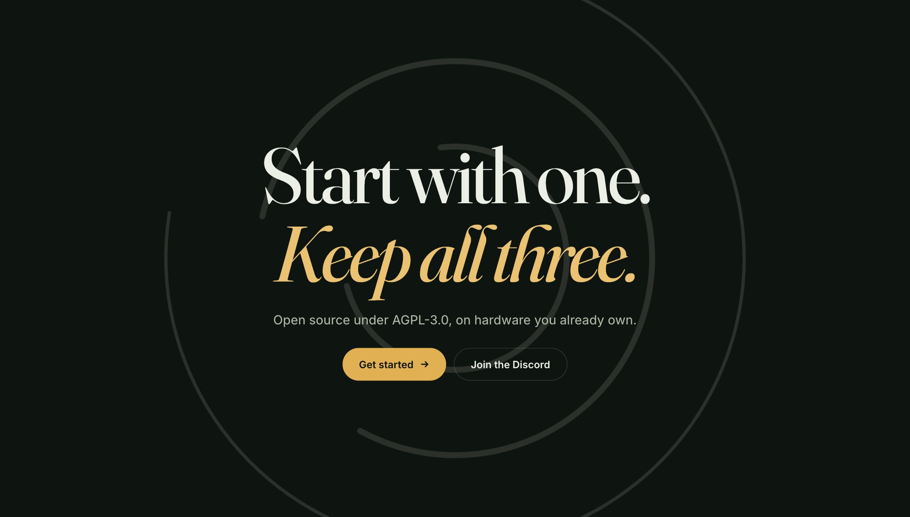
</p>

<p align="center"><sub>Made with ❤️ by <a href="https://github.com/neooriginal">Neo</a> · <a href="https://github.com/NeoLabs-Systems">NeoLabs Systems</a></sub></p>
